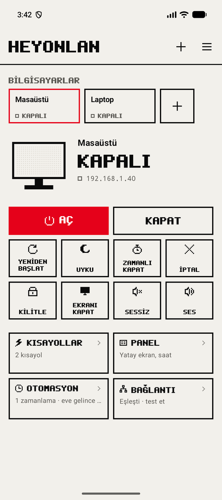
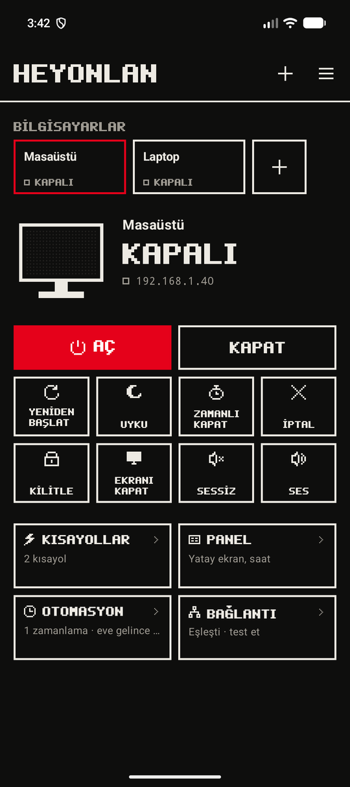
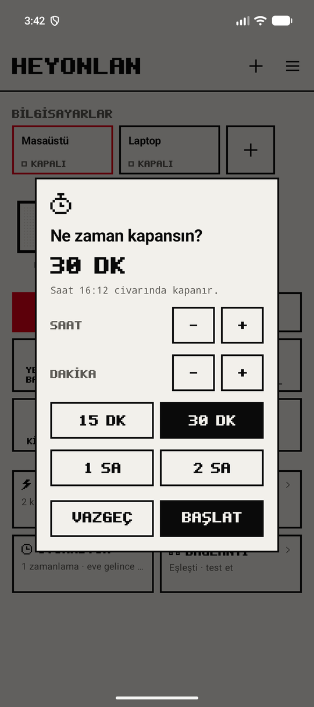
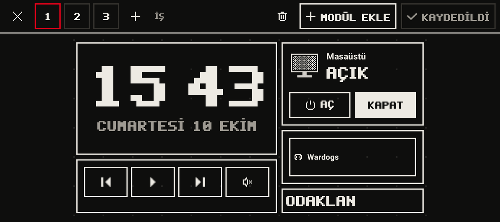

# HeyOnLan

Evdeki bilgisayarını telefondan **açıp kapatan** Android uygulaması. Koltuktan kalkmadan bilgisayarı açarsın, açık unuttuysan yataktan kapatırsın.

  
  
  

## Neler yapıyor?

- **Aç / kapat:** tek dokunuşla. Bilgisayarın gerçekten açık mı kapalı mı olduğunu gösterir.
- **Diğer komutlar:** yeniden başlat, uyku, istediğin süre sonra kapat, kilitle, ekranı kapat, ses aç/kıs.
- **Kısayollar:** telefondan dokununca bilgisayarda bir Steam oyunu, program ya da web sayfası açılır.
- **Bilgiler:** bilgisayar açıkken işlemci, bellek, sıcaklık ve ne zamandır açık olduğu.
- **Otomasyon:** belirli saatlerde aç/kapat, eve gelip Wi-Fi'a bağlanınca aç.
- **Widget ve kısayollar:** ana ekrana küçük yuvarlak tuşlar, bildirim paneline kutucuk.
- **Sesli komut:** "Hey Google, PC Aç'ı aç" (Bixby'de de çalışır).
- **Panel:** telefonu yatay koyunca masada küçük bir bilgi ekranı olur. Saat, kullanım değerleri ve kısayolları parmağınla istediğin yere sürüklersin; şarj olurken kendiliğinden açılabilir.

  
  

## Ne gerekiyor?

- Android 13 veya üstü bir telefon
- Windows 10 / 11 bilgisayar, **ethernet kablosuyla** modeme bağlı (Wi-Fi ile açılmaz)
- Telefon ve bilgisayar **aynı ev ağında** olmalı (misafir Wi-Fi olmaz)

## Kurulum (5 dakika)

### 1. Telefona uygulamayı kur
1. Telefondan **[HeyOnLan.apk](https://github.com/Hazallul/HeyOnLan-surumler/releases/latest/download/HeyOnLan.apk)** dosyasını indir.
2. Dosyayı aç. "Bilinmeyen uygulamalar" uyarısı çıkarsa **Ayarlar → Bu kaynaktan izin ver** de, sonra **Yükle**.

### 2. Bilgisayarı hazırla
1. Bilgisayardan **[HeyOnLan-Kurulum.bat](https://github.com/Hazallul/HeyOnLan-surumler/releases/latest/download/HeyOnLan-Kurulum.bat)** dosyasını indir.
2. Çift tıkla, izin sorarsa **Evet** de.
3. Pencerede bir **IP** (ör. 192.168.1.40) ve **6 haneli kod** çıkar. Pencereyi kapatma.

> Windows "bilgisayarınız korundu" derse **Ek bilgi → Yine de çalıştır**'a bas.

### 3. Eşleştir
Uygulamada **Kuruluma başla**'ya bas, IP'yi ve kodu gir, **Eşleştir**. Bu kadar.

### 4. BIOS ayarı (sadece açma için, bir kez)
Bilgisayar kapalıyken açılabilmesi için BIOS'ta **Wake on LAN** açık olmalı. Bilgisayarı açarken F2 ya da Del'e bas, "Wake on LAN", "Power On By PCI-E" ya da "Resume by LAN" benzeri ayarı **Enabled** yap. Anakarta göre adı değişir.

## Güncelleme

Yeni sürüm çıkınca uygulamanın sağ üstündeki menüde **YENİ SÜRÜM** yazar. **İndir**'e bas, açılan dosyayı kur. Eski uygulamanın üstüne kurulur; **silmen gerekmez, ayarların kalır.**

Bilgisayardaki kurulum için de yeni bir sürüm çıkarsa bat dosyasını tekrar çalıştırıp uygulamada **Bağlantı → Yeniden eşleştir** yapman yeterli.

## Çalışmıyorsa

- **Açılmıyor:** ethernet kablosu takılı mı, BIOS'ta Wake on LAN açık mı? Telefon aynı Wi-Fi'da mı?
- **Kapanmıyor / komutlar gitmiyor:** uygulamada **Bağlantı → Test et**. Sorunu adım adım gösterir.
- **IP değişti:** uygulama bilgisayarı ağda kendisi bulur; bulamazsa Bağlantı sayfasında test et.

## Kurulum bilgisayarda ne yapıyor?

Bat dosyası düz metindir, Not Defteri ile açıp okuyabilirsin. Özetle:

- Windows'un kendi **OpenSSH Server**'ını açar (telefon komutları bununla gönderir).
- Bağlantıya **sadece ev ağından** izin verir, şifreyle girişi kapatır.
- Telefonun anahtarını, **sadece belirli komutları** (kapat, yeniden başlat, uyku, kilit, ses, kısayollar…) çalıştırabilecek şekilde ekler. Telefon bilgisayarında başka hiçbir şey yapamaz.
- Wake on LAN için ağ kartı ve hızlı başlatma ayarlarını yapar.

---

Bu depoda sadece uygulamanın sürümleri (APK) ve bilgisayar kurulum dosyası bulunur.
