# HeyOnLan

Evdeki bilgisayarını telefondan **açıp kapatan** ve uzaktan kumanda gibi yöneten Android uygulaması. Koltuktan kalkmadan bilgisayarı açarsın, açık unuttuysan yataktan kapatırsın, müziği durdurur, sesi kısar, fotoğrafı bilgisayara atarsın.

İki görünüm var, menüden istediğin zaman geçersin: **KATALOG** (kâğıt ve mürekkep, açık ya da koyu) ve **RUNNER** (siyah zemin, asit yeşili).

  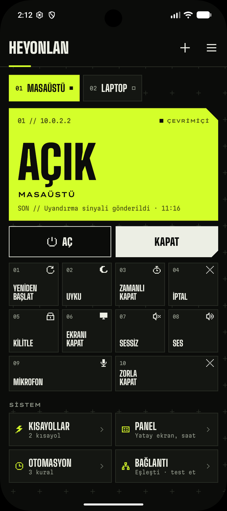
  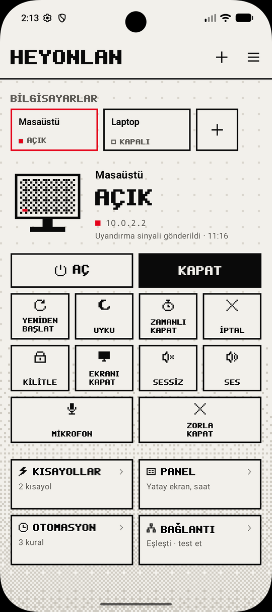
  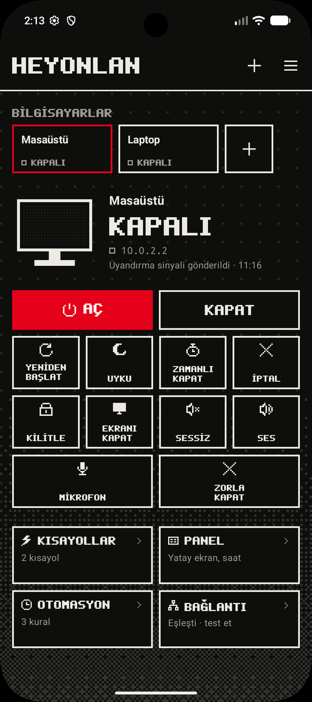

## Neler yapıyor?

### Aç, kapat ve kumanda
- **Aç / kapat:** tek dokunuşla. Bilgisayarın gerçekten açık mı kapalı mı olduğunu ölçüp gösterir.
- **Güç:** yeniden başlat, uyku, istediğin süre sonra kapat, zamanlı kapatmayı iptal et.
- **Masaüstü:** kilitle, **ekranı aç / kapat** (açıksa kapatır, kapalıysa açar), sessiz, **ses yüzdesi** (çubuğu parmağınla kaydır), **mikrofonu kapat / aç** (kapalıyken tuş belli olur), donan oyunu ya da programı **zorla kapat**.
- **Kısayollar:** dokununca bilgisayarda bir Steam oyunu, program ya da web sayfası açılır, ya da bir program kapanır. İstersen telefonun ana ekranına simge olarak eklersin.
- **Pano:** telefonda bir yazıyı ya da bağlantıyı seçip **Paylaş → HeyOnLan** dersen bilgisayarın panosuna gider, Ctrl+V ile yapıştırırsın. Tersi için bildirim panelindeki **PC panosu** kutucuğuna dokun: bilgisayarda kopyaladığın yazı telefona gelir.
- **Bilgisayardan bildirim:** menüden **Bilgisayardan bildirim**'i aç, bilgisayarda komut satırına `heyonlan-bildir Render bitti` yaz; telefon evdeyse bildirim saniyeler içinde gelir. Uzun bir işin sonuna eklersen (`... && heyonlan-bildir`) iş bitince haber verir. Açıkken bildirim panelinde küçük bir "haber bekleniyor" satırı durur.

### Bilgisayara dosya gönder
Galeride, Dosyalar'da ya da WhatsApp'ta **Paylaş**'a bas: paylaş ekranının en üstünde bilgisayarlarının adları çıkar (ör. **Masaüstü**), dokununca sormadan oraya gönderir. Uygulama listesinden **HeyOnLan**'ı da seçebilirsin. Fotoğraf ve dosyalar bilgisayarın masaüstündeki **HeyOnLan-Depo** klasörüne düşer (klasör yoksa kendisi oluşturur). Birden fazla bilgisayarın varsa hangisine gideceğini sorar. Aynı adda dosya varsa üstüne yazmaz.

  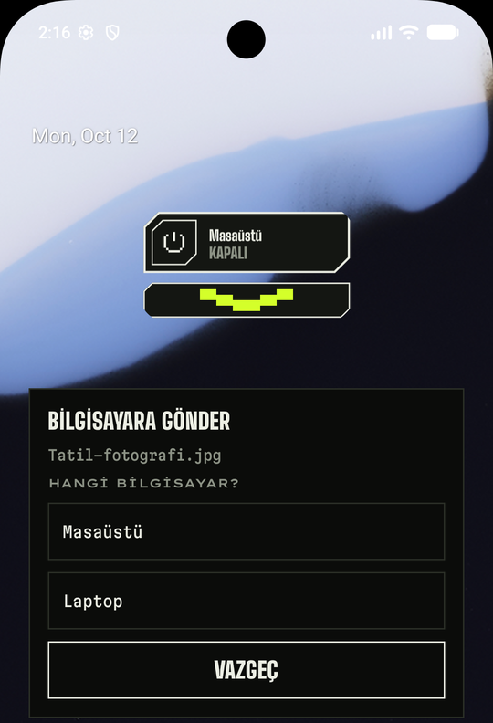

### Widget'lar
Dört widget var: **Tuş** (tek yuvarlak tuş), **Durum** (tuş, ad ve durum), **Hepsi** (bütün bilgisayarlar yan yana) ve **Kumanda**.

**Kumanda**'nın altındaki oka basınca widget'ın hemen altında seçtiğin işler açılır: uyku, kilitle, sessiz, oynat, mikrofon, kısayolların. Widget'ı basılı tutup büyütürsen aynı tuşlar widget'ın içinde görünür. Hangi işlerin çıkacağını uygulamada **Kısayollar** sayfasından seçersin.

  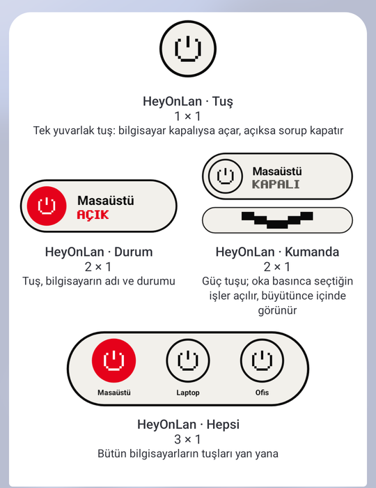
  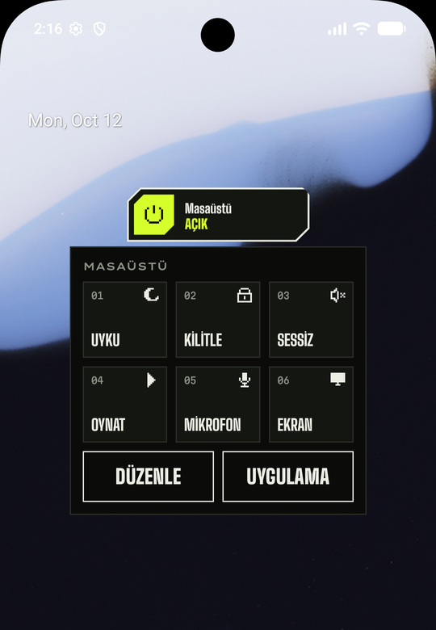

### Panel
Telefonu yatay koyunca masada küçük bir bilgi ekranı olur: saat, çalan şarkı ve albüm kapağı, medya tuşları, işlemci, bellek, ekran kartı, sıcaklık, ağ hızı, Stream Deck gibi büyük kısayol tuşları, **bilgisayarın ekranı** (küçük, gri) ve **son 24 saatin işlemci ve sıcaklık grafiği**. Düzeni parmağınla kurarsın; dört ayrı düzen arasında yana kaydırarak geçersin. Şarj olurken kendiliğinden açılabilir. Panel ya da uygulama açıkken bilgisayar çok ısınırsa telefona uyarı gelir.

  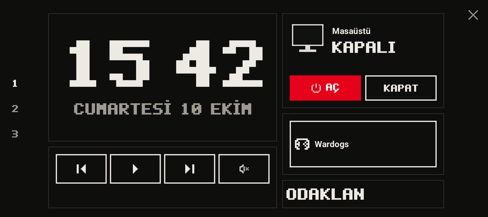

  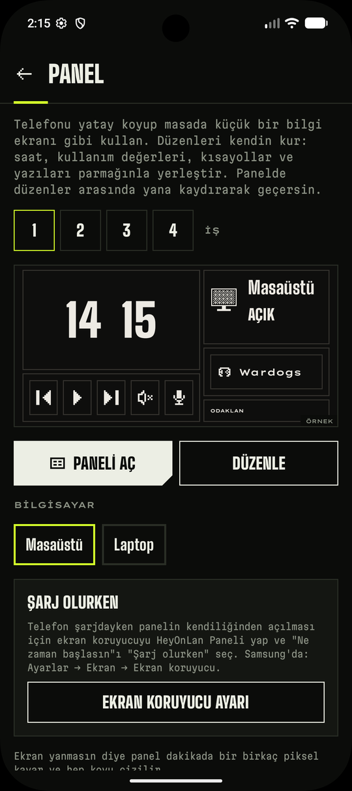

### Otomasyon
Kural: **ne zaman** ve sırayla **ne yapılacak**.
- **Saatte:** ör. hafta içi 08:30'da aç, sonra Discord'u başlat.
- **Eve gelince:** ev konumuna girip ev Wi-Fi'ına bağlanınca aç.
- **Evden çıkınca:** telefon ağdan çıkınca ve bilgisayara bir süre dokunulmayınca bilgisayar kendini uyutur ya da kapatır.
- **Şarja takınca:** ör. gece 23:00'ten sonra telefonu şarja takınca bilgisayarı kapat.
- **Boşta kalınca:** bilgisayara ör. 30 dakika kimse dokunmazsa uyusun ya da kapansın (render, derleme gibi işlemciyi meşgul eden işler sürerken beklenir).

Adımların arasına bekleme koyabilirsin (ör. aç, 2 dakika bekle, oyunu başlat); sırayı adımı basılı tutup sürükleyerek değiştirirsin, bir kuralın kopyasını oluşturabilirsin. Sonuç bildirimle gelir.

  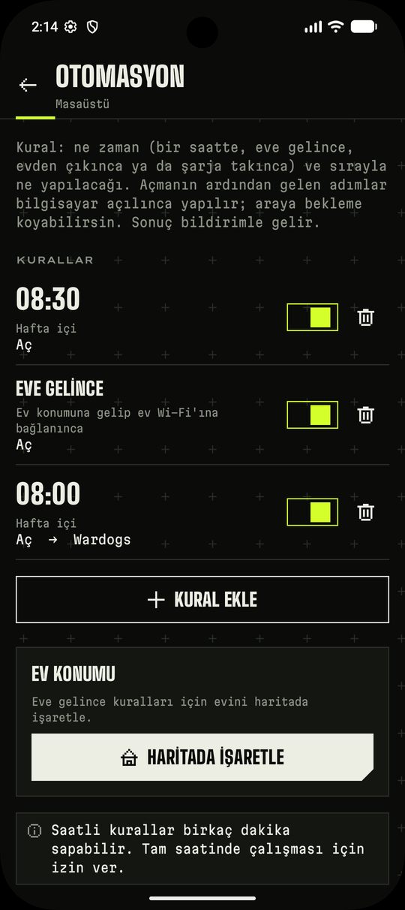
  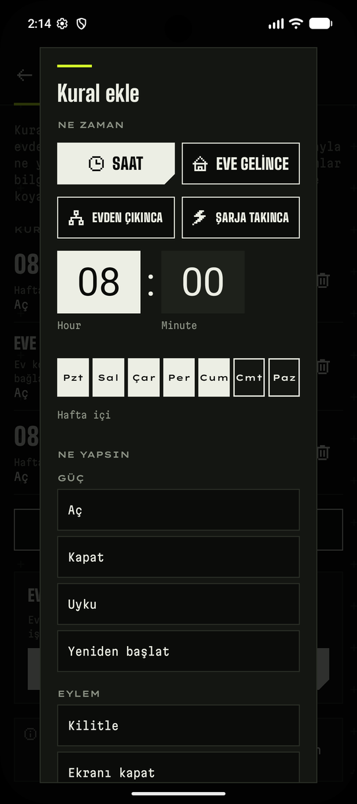

### Diğerleri
- **Sesli komut:** menüden **Asistanla aç / kapat**'ı aç, sonra "Hey Google, HeyOnLan'ı aç" de. Bilgisayar kapalıysa açılır, açıksa 5 saniye geri sayıp kapanır.
- **Hızlı ayarlar kutucuğu:** bildirim panelinden tek dokunuşla aç / kapat.
- **Yedekle / geri yükle:** telefon değişince menüden **Yedekle** ile bilgisayarlar, kısayollar, kurallar ve panel tek dosyaya kaydedilir; yeni telefonda **Geri yükle** dersin, yeniden eşleştirme gerekmez. Dosya bilgisayarlarına giriş anahtarını içerir: kimseyle paylaşma.
- **İşlemci sıcaklığı:** Windows işlemci sıcaklığını çoğu masaüstü bilgisayarda vermez. Bilgisayarda [LibreHardwareMonitor](https://github.com/LibreHardwareMonitor/LibreHardwareMonitor) ya da HWiNFO ("Gadget'a raporla" açık) çalışıyorsa HeyOnLan onların okuduğu değeri gösterir.
- **Tasker, Home Assistant, MacroDroid:** menüden **Dış uygulamalar**'ı açınca bu uygulamalar bilgisayarı açıp uyutabilir ya da kapatabilir. Varsayılan kapalı.

  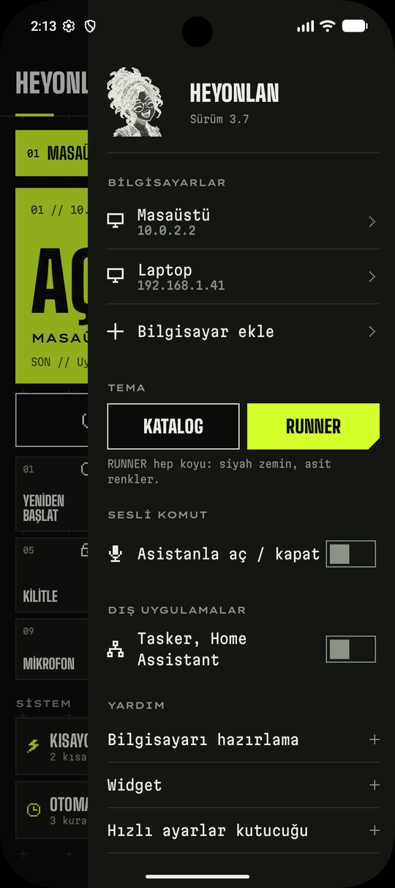

## Ne gerekiyor?

- Android 13 veya üstü bir telefon
- Windows 10 / 11 bilgisayar
- Telefon ve bilgisayar **aynı ev ağında** olmalı (misafir Wi-Fi olmaz)
- Kapalı bilgisayarı açmak için bilgisayar modeme **ethernet kablosuyla** bağlı olmalı. Wi-Fi ile bağlı bilgisayar tam kapalıyken açılamaz, uykudayken (ağ kartı destekliyorsa) açılır.

## Kurulum (5 dakika)

### 1. Telefona uygulamayı kur
1. Telefondan **[son sürüm sayfasını](https://github.com/Hazallul/HeyOnLan-surumler/releases/latest)** aç ve `HeyOnLan-<sürüm>.apk` dosyasını indir.
2. Dosyayı aç. "Bilinmeyen uygulamalar" uyarısı çıkarsa **Ayarlar → Bu kaynaktan izin ver** de, sonra **Yükle**.

> Play Protect "uygulamayı tanımıyor, taramaya gönder" derse **taramayı** seç; tarama bitince kurulum sürer. Google her yeni sürümü ilk kez gördüğü için bu uyarı güncellemelerde de çıkabilir, normaldir.

### 2. Bilgisayarı hazırla
1. Bilgisayardan **[son sürüm sayfasını](https://github.com/Hazallul/HeyOnLan-surumler/releases/latest)** aç ve `HeyOnLan-<sürüm>.exe` dosyasını indir.
2. Çift tıkla, **Kur**'a bas, izin sorarsa **Evet** de.
3. Kurulum bitince bir **IP** (ör. 192.168.1.40) ve **6 haneli kod** çıkar. Pencereyi kapatma.

> Windows "bilgisayarınız korundu" derse **Ek bilgi → Yine de çalıştır**'a bas.

### 3. Eşleştir
Uygulamada **Kuruluma başla**'ya bas, IP'yi ve kodu gir, **Eşleştir**. Bu kadar.

### 4. BIOS ayarı (sadece açma için, bir kez)
Bilgisayar kapalıyken açılabilmesi için BIOS'ta **Wake on LAN** açık olmalı. Bilgisayarı açarken F2 ya da Del'e bas, "Wake on LAN", "Power On By PCI-E" ya da "Resume by LAN" benzeri ayarı **Enabled** yap. Anakarta göre adı değişir.

## Güncelleme

Yeni sürüm çıkınca uygulamanın menüsünde **YENİ SÜRÜM** yazar. **Güncelle**'ye bas; uygulama yeni sürümü kendisi indirip kurar, **ayarların kalır.** İlk seferde Android "bu uygulama başka uygulama yükleyebilsin mi?" diye bir kez izin ister. Play Protect tarama önerirse yukarıdaki gibi taramayı seç.

Bilgisayardaki kurulum da **kendiliğinden güncellenir**: uygulama bilgisayarın eski kaldığını görünce yenisini kurdurur, sana bir şey yaptırmaz. Eskiden kurulum dosyasıyla (bat) kurduysan bilgisayar bu güncellemeyle HeyOnLan uygulamasına geçer. Bilgisayar yeni dosyayı sadece bu sayfadaki sürümlerden indirir ve uygulamanın beklediği dosyayla birebir aynı değilse kurmaz.

> **1.4'ten önceki sürümlerden geçiyorsan (3.x):** bu sefer bir kereliğine elle yap: telefona yeni APK'yı kur, bilgisayarda **HeyOnLan-<sürüm>.exe**'yi bir kez çalıştır (yeniden eşleştirmen gerekmez). Sonraki güncellemeler kendiliğinden gelir.

## Çalışmıyorsa

- **Açılmıyor:** ethernet kablosu takılı mı, BIOS'ta Wake on LAN açık mı? Telefon aynı Wi-Fi'da mı?
- **Kapanmıyor / komutlar gitmiyor:** uygulamada **Bağlantı → Test et**. Sorunu adım adım gösterir.
- **"Kurulum eski" ya da "güncellenemedi" diyor:** son sürümün exe'sini bilgisayarda bir kez çalıştır.
- **IP değişti:** uygulama bilgisayarı ağda kendisi bulur; bulamazsa Bağlantı sayfasında test et.
- **Otomasyon geç çalışıyor:** Otomasyon sayfasındaki **Tam saat izni** ve **Pil kısıtlamasını kaldır** uyarılarına bak.

## Kurulum bilgisayarda ne yapıyor?

HeyOnLan.exe kendini `Program Files\HeyOnLan`'a kurar (Başlat menüsünde **HeyOnLan**) ve içindeki kurulum betiğini çalıştırır. Betik sürüm sayfasındaki `HeyOnLan-Kurulum.bat` ile aynıdır; düz metindir, Not Defteri ile açıp okuyabilirsin. Özetle:

- Windows'un kendi **OpenSSH Server**'ını açar (telefon komutları bununla gönderir).
- Bağlantıya **sadece ev ağından** izin verir, şifreyle girişi kapatır.
- Telefonun anahtarını, **sadece belirli komutları** (kapat, uyku, kilit, ses, kısayollar, dosya alma…) çalıştırabilecek şekilde ekler. Telefon bilgisayarında başka hiçbir şey yapamaz; gönderdiğin dosyalar sadece masaüstündeki **HeyOnLan-Depo** klasörüne yazılabilir.
- Wake on LAN için ağ kartı ve hızlı başlatma ayarlarını yapar.
- "Evden çıkınca" kuralı için, sen telefondan açmadıkça kapalı duran küçük bir zamanlanmış görev ekler.
- Panelin 24 saatlik grafiği için 5 dakikada bir küçük bir ölçüm yapan bir görev ekler (yarım saniye sürer).
- `heyonlan-bildir` komutunu ekler (telefona bildirim).
- Kendini güncellemek için bir zamanlanmış görev daha ekler. Bu görev sadece telefon isteyince çalışır ve kurulumun yenisini sadece bu deponun sürümlerinden indirir.

---

Bu depoda sadece uygulamanın sürümleri bulunur: telefon (APK), saat (`HeyOnLan-Saat-<sürüm>.apk`) ve bilgisayar (exe). `HeyOnLan-Kurulum.bat` çok eski kurulumların kendini güncelleyebilmesi için duruyor.
