# HeyOnLan

Evdeki Windows bilgisayarını telefondan **açıp kapatan** ve uzaktan kumanda gibi yöneten uygulama. Koltuktan kalkmadan bilgisayarı açarsın, açık unuttuysan yataktan kapatırsın; müziği durdurur, sesi kısar, oyunu başlatır, fotoğrafı bilgisayara atarsın.

Üç parçası var, üçü de aynı bilgisayarı yönetir:

| | Ne işe yarar |
|---|---|
| **Telefon** (Android) | Asıl kumanda: aç, kapat, kısayollar, otomasyon, panel, widget'lar, sesli komut |
| **Saat** (Wear OS) | Bileğinden aç / kapat, ses, kısayollar; telefonun üzerinden çalışır |
| **Bilgisayar** (HeyOnLan.exe ya da sadece kurulum dosyası) | Telefonun komutlarını alır; istersen kısayolları, otomasyonu ve paneli bilgisayardan düzenlersin, telefonun galerisini görürsün |

<p>
  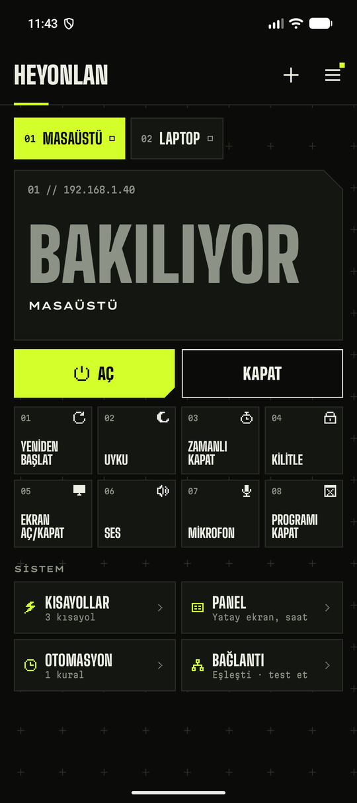
  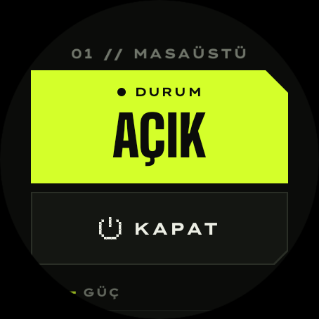
</p>
<p>
  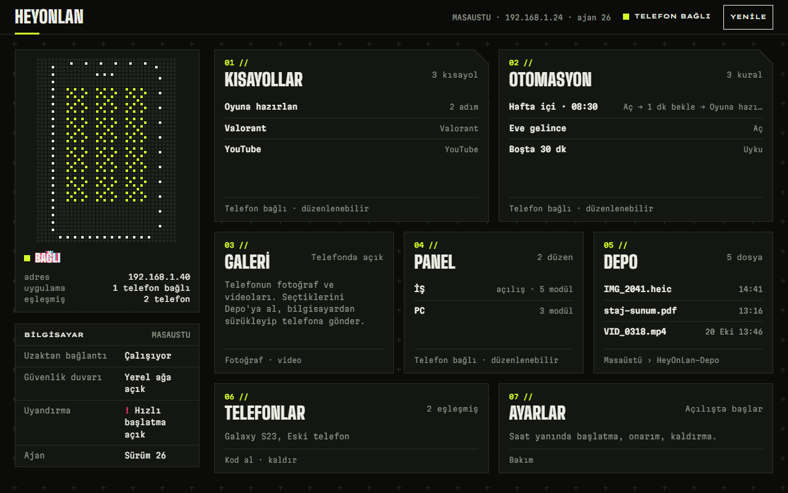
</p>

## Dört tema, üç cihazda aynı

Temayı telefonun menüsünden seçersin; **saat ve bilgisayar uygulaması da kendiliğinden aynı temaya geçer.**

- **KATALOG:** kâğıt ve mürekkep, piksel yazılar. Açık, koyu ya da telefona uy.
- **RUNNER:** siyah zemin, asit yeşili, yarış ekranı gibi büyük yazılar. Hep koyu.
- **ATÖLYE:** yumuşak köşeli tuş takımı, sıcak renkler. Açık ya da koyu.
- **KAPAK:** anime manga kapağı: gök mavisi, eğik kareler, maskot. Bilgisayarı açınca darbe karesi ve şok dalgası. Hep açık.

<p>
  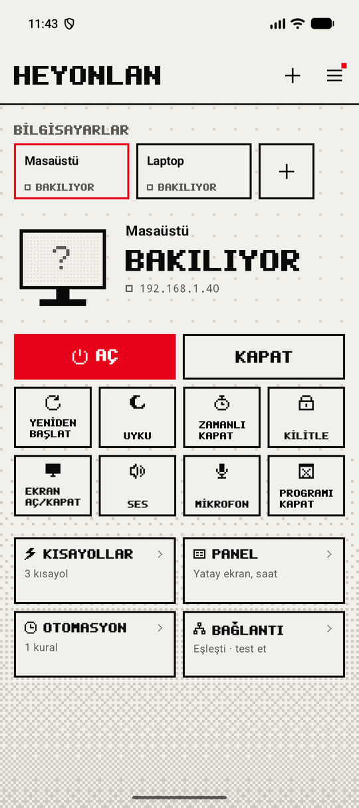
  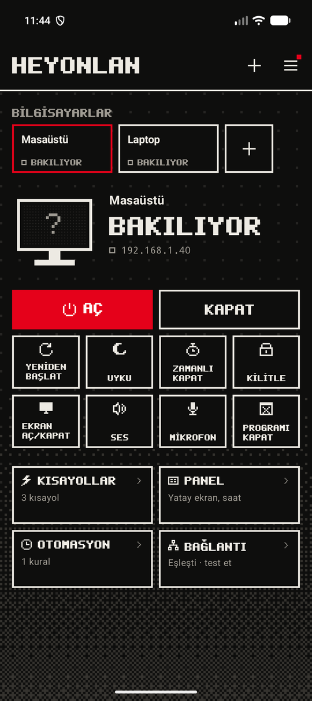
  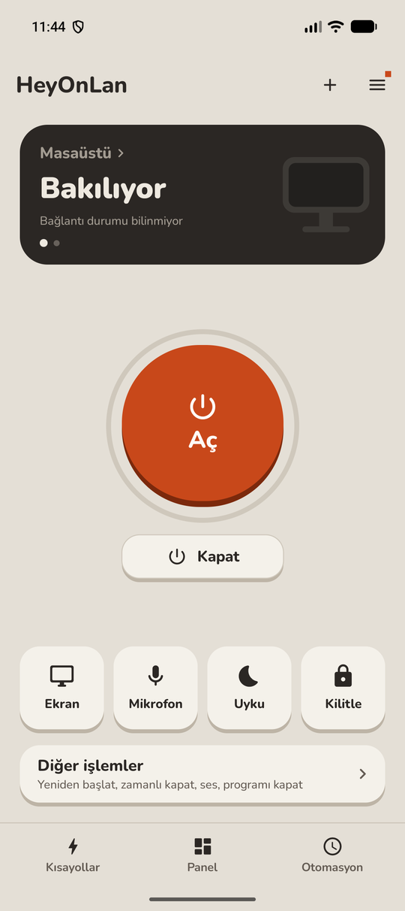
  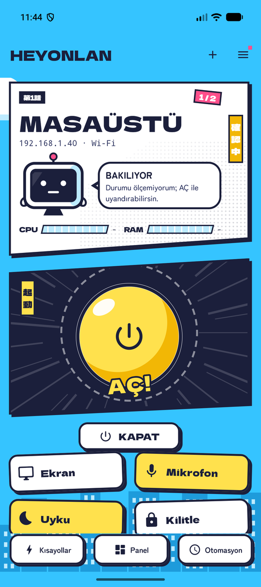
</p>
<p>
  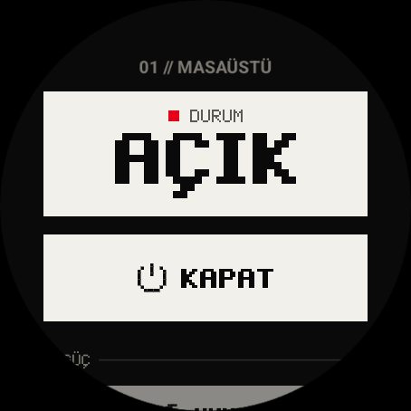
  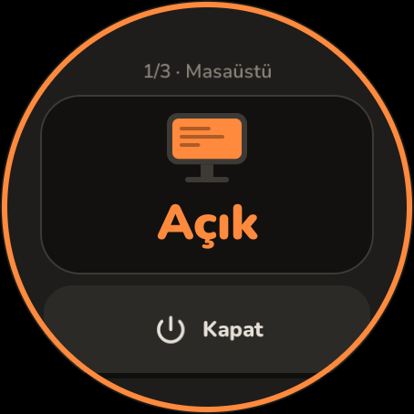
  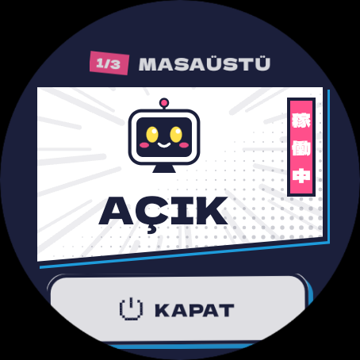
</p>
<p>
  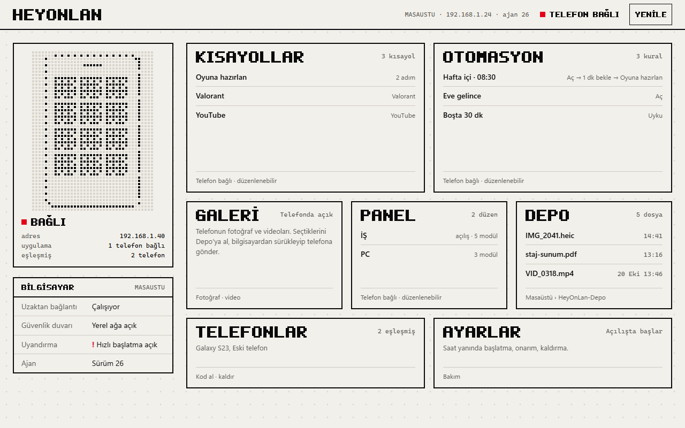
  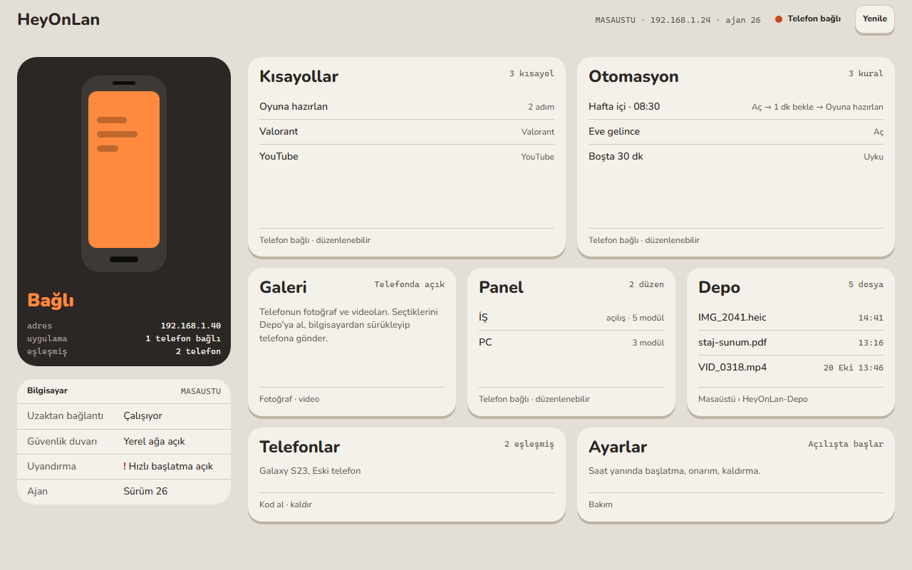
  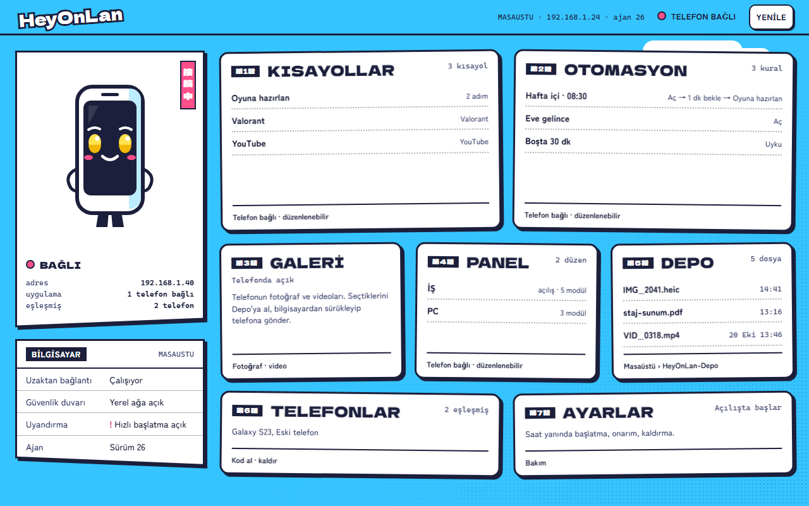
</p>

## Türkçe ve İngilizce

Uygulama telefonun dilinde açılır: telefon Türkçeyse Türkçe, başka bir dildeyse İngilizce. Menüdeki **DİL** bölümünden elle de seçebilirsin (**Otomatik / Türkçe / English**). Saat ve bilgisayar uygulaması bu seçimi izler; Otomatik'te her biri kendi dilini kullanır. Uygulama İngilizceyken sesli komut İngilizceyi de anlar ("turn on the computer", "volume 50"); Türkçe komutlar her zaman çalışır.

<p>
  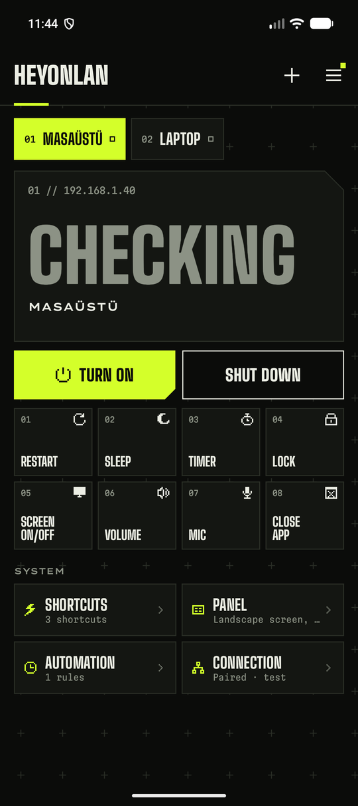
  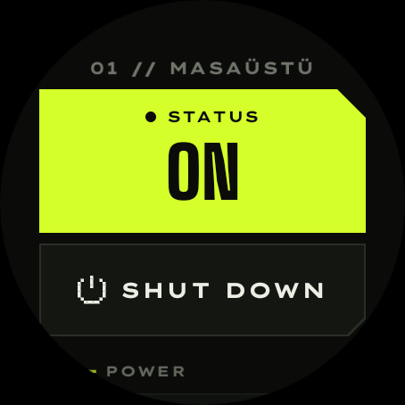
  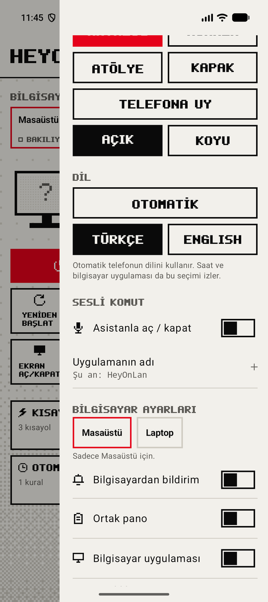
</p>
<p>
  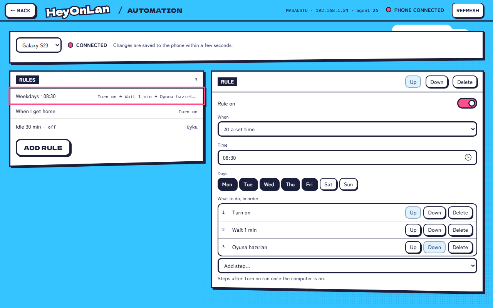
</p>

## Telefonda neler var?

### Aç, kapat ve kumanda
- **Aç / kapat:** tek dokunuşla. Bilgisayarın gerçekten açık mı kapalı mı olduğunu ölçüp gösterir; ölçemiyorsa uydurmaz, "hazır" der.
- **Güç:** yeniden başlat, uyku, istediğin süre sonra kapat, zamanlı kapatmayı iptal et.
- **Masaüstü:** kilitle, **ekranı aç / kapat**, sessiz, **ses yüzdesi** (çubuğu parmağınla kaydır), **mikrofonu kapat / aç**, donan oyunu ya da programı **zorla kapat**.
- **Birden fazla bilgisayar:** üstteki listeden seçersin ya da ana ekranda yana kaydırırsın.

### Kısayollar
Dokununca bilgisayarda bir **Steam oyunu**, **program** ya da **web sayfası** açılır, ya da kilitle, sesi kapat gibi hazır bir eylem çalışır. Birkaç adımı sıraya da koyabilirsin (ör. Discord'u aç, sesi %40 yap, oyunu başlat). Program seçerken bilgisayardaki oyun ve programların listesi gelir, tahmin etmen gerekmez. İstersen kısayolu telefonun ana ekranına simge olarak eklersin.

<p>
  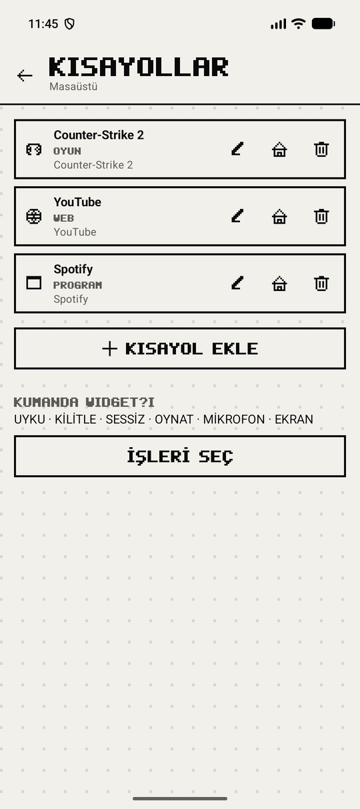
</p>

### Panel
Telefonu yatay koyunca masada küçük bir bilgi ekranı olur: saat, çalan şarkı ve albüm kapağı, medya tuşları, işlemci, bellek, ekran kartı, sıcaklık, ağ hızı, Stream Deck gibi büyük kısayol tuşları, bilgisayarın ekranı (küçük, gri) ve son 24 saatin işlemci ve sıcaklık grafiği. Düzeni parmağınla kurarsın; dört ayrı düzen arasında yana kaydırarak geçersin. Şarj olurken kendiliğinden açılabilir. Bilgisayar çok ısınırsa telefona uyarı gelir.

<p>
  
</p>

### Otomasyon
Kural: **ne zaman** ve sırayla **ne yapılacak**.
- **Saatte:** ör. hafta içi 08:30'da aç, sonra Discord'u başlat.
- **Eve gelince:** ev konumuna girip ev Wi-Fi'ına bağlanınca aç.
- **Evden çıkınca:** telefon ağdan çıkınca ve bilgisayara bir süre dokunulmayınca bilgisayar kendini uyutur ya da kapatır.
- **Şarja takınca:** ör. gece 23:00'ten sonra telefonu şarja takınca bilgisayarı kapat.
- **Boşta kalınca:** bilgisayara ör. 30 dakika kimse dokunmazsa uyusun ya da kapansın (render, derleme gibi işler sürerken beklenir).

Adımların arasına bekleme koyabilirsin (ör. aç, 2 dakika bekle, oyunu başlat). Saatli kuralları telefon evde olmasa da bilgisayar kendisi yapar. Sonuç bildirimle gelir.

<p>
  
</p>

### Dosya, pano ve bildirim
- **Bilgisayara gönder:** Galeride, Dosyalar'da ya da WhatsApp'ta **Paylaş**'a bas; paylaş ekranının en üstünde bilgisayarlarının adları çıkar, dokununca oraya gönderir. Dosyalar masaüstündeki **HeyOnLan-Depo** klasörüne düşer, aynı adda dosyanın üstüne yazmaz.
- **Pano:** telefonda bir yazıyı seçip **Paylaş → HeyOnLan** dersen bilgisayarın panosuna gider. Tersi için bildirim panelindeki **PC panosu** kutucuğu. İstersen **ortak pano**yu açarsın: bilgisayarda kopyaladığın yazı telefona da gelir.
- **Bilgisayardan bildirim:** bilgisayarda `heyonlan-bildir Render bitti` yazınca telefona bildirim gelir. Uzun bir işin sonuna eklersen (`... && heyonlan-bildir`) iş bitince haber verir.

<p>
  
</p>

### Widget'lar
Dört widget var: **Tuş** (tek yuvarlak tuş), **Durum** (tuş, ad ve durum), **Hepsi** (bütün bilgisayarlar yan yana) ve **Kumanda**. Kumanda'nın altındaki oka basınca seçtiğin işler açılır (uyku, kilitle, sessiz, oynat, mikrofon, kısayolların); widget'ı büyütürsen aynı tuşlar içinde görünür. Widget'lar da seçtiğin temayla çizilir.

<p>
  
  
</p>

### Diğerleri
- **Sesli komut:** menüden **Asistanla aç / kapat**'ı aç, sonra "Hey Google, HeyOnLan'ı aç" de. Bilgisayar kapalıysa açılır, açıksa 5 saniye geri sayıp kapanır. "Masaüstü uyku", "sesi yüzde 40 yap" gibi komutlar da var.
- **Hızlı ayarlar kutucuğu:** bildirim panelinden tek dokunuşla aç / kapat.
- **Yedekle / geri yükle:** telefon değişince bilgisayarlar, kısayollar, kurallar ve panel tek dosyaya kaydedilir; yeni telefonda geri yüklersin, yeniden eşleştirme gerekmez. Dosya bilgisayarlarına giriş anahtarını içerir: kimseyle paylaşma.
- **İşlemci sıcaklığı:** Windows bunu çoğu masaüstünde vermez. [LibreHardwareMonitor](https://github.com/LibreHardwareMonitor/LibreHardwareMonitor) ya da HWiNFO ("Gadget'a raporla" açık) çalışıyorsa HeyOnLan onların değerini gösterir.
- **Tasker, Home Assistant, MacroDroid:** menüden **Dış uygulamalar**'ı açınca bu uygulamalar bilgisayarı açıp uyutabilir ya da kapatabilir. Varsayılan kapalı.

## Saatte neler var?

Saat uygulaması telefondaki bilgisayarları gösterir ve komutları telefonun üzerinden gönderir; saatin ayrıca eşleşmesi gerekmez.

- Bilgisayarın durumu, **AÇ / KAPAT**, yeniden başlat, uyku, kilitle, ekran, mikrofon.
- **Ses ekranı:** sesi çerçeveyle ya da parmağınla aç, kıs, sustur.
- Telefondaki **kısayollar** saatte de tuş olarak çıkar.
- Galaxy Watch Classic'te dönen çerçeveyle yumuşak kaydırma.
- Tema ve dil telefonu izler. En altta saatin sürümü yazar; telefon daha yeniyse **GÜNCELLE** çıkar, saat kendini günceller.

<p>
  
  
  
</p>

## Bilgisayarda iki yol

Telefonun bilgisayara komut gönderebilmesi için bilgisayara bir kez kurulum yapılır. İki yolu var, ikisi de aynı kurulumu yapar:

| | **HeyOnLan.exe** (önerilen) | **Sadece kurulum dosyası** (`HeyOnLan-Kurulum.bat`) |
|---|---|---|
| Kurulum | Çift tıkla, **Kur**, adımlar ekranda görünür | Çift tıkla, izin sorarsa **Evet**; siyah pencerede ilerler |
| Telefonla aç / kapat, kısayol, otomasyon, panel, dosya, pano | Var | Var |
| Bilgisayarda pencere | Var: saat yanında (tepside) durur | Yok: her şey telefondan |
| Kısayol, otomasyon ve paneli **bilgisayardan düzenleme** | Var | Yok |
| Telefonun **galerisi** bilgisayarda | Var | Yok |
| Gelen dosyalar (**Depo**), bağlı telefonlar, yeni kod alma | Uygulamada | Masaüstündeki klasör; yeni kod için dosyayı yeniden çalıştır |

Bilgisayarda bir uygulama istemiyorsan bat yeter: bir kez çalıştırıp telefonla eşleştirirsin, gerisini telefondan yaparsın. Kurulum güncellendiğinde bilgisayar HeyOnLan uygulamasına geçer; arka planda durur, açmak zorunda değilsin.

### Bilgisayar uygulamasında neler var?

- **Ana ekran:** bilgisayarın ve telefonun durumu, kısayolların, kuralların, panel düzenlerin ve gelen dosyalar tek bakışta.
- **Kısayollar ve Otomasyon:** telefondakilerin aynısı; burada değiştirdiğin şey telefon evdeyse birkaç saniyede telefona kaydedilir. Program seçerken bilgisayarda bulunan oyun ve programlar listelenir, istersen Windows'un dosya seçme penceresinden seçersin.
- **Panel:** telefonun panel düzenlerini fareyle kurarsın; telefonda nasıl görünecekse öyle görünür.
- **Galeri:** telefonun fotoğraf ve videoları; seçtiklerini Depo'ya alırsın, bilgisayardan dosyaları sürükleyip telefonun galerisine gönderirsin.
- **Depo:** telefondan gelen dosyalar.
- **Telefonlar:** bağlı telefonlar, yeni telefon için kod al, telefonu kaldır.
- **Ayarlar:** saat yanında başlat, kurulumu onar, kaldır.

<p>
  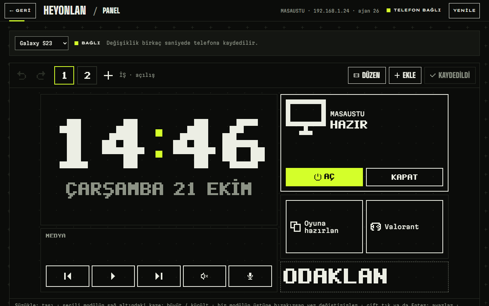
  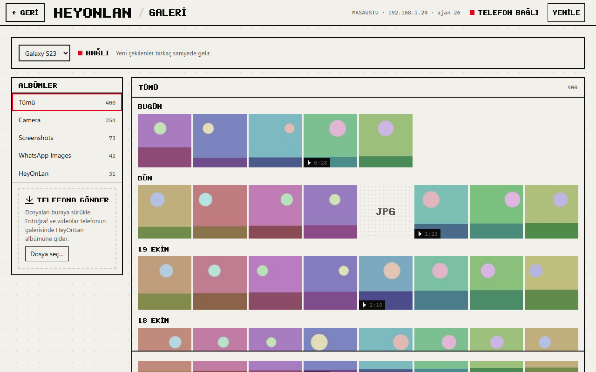
</p>
<p>
  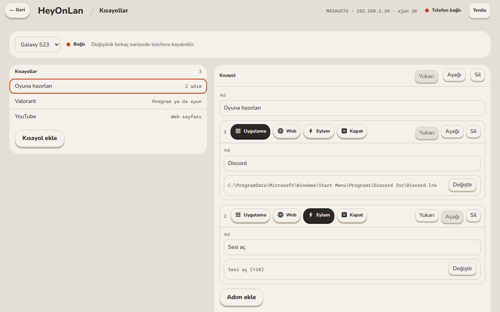
</p>

## Ne gerekiyor?

- Android 13 veya üstü bir telefon
- Windows 10 / 11 bilgisayar
- Saat için (isteğe bağlı): Wear OS 4 veya üstü bir saat (ör. Galaxy Watch 4 ve sonrası)
- Telefon ve bilgisayar **aynı ev ağında** olmalı (misafir Wi-Fi olmaz)
- Kapalı bilgisayarı açmak için bilgisayar modeme **ethernet kablosuyla** bağlı olmalı. Wi-Fi ile bağlı bilgisayar tam kapalıyken açılamaz, uykudayken (ağ kartı destekliyorsa) açılır.

## Kurulum (5 dakika)

### 1. Telefona uygulamayı kur
1. Telefondan **[son sürüm sayfasını](https://github.com/Hazallul/HeyOnLan-surumler/releases/latest)** aç ve `HeyOnLan-<sürüm>.apk` dosyasını indir.
2. Dosyayı aç. "Bilinmeyen uygulamalar" uyarısı çıkarsa **Ayarlar → Bu kaynaktan izin ver** de, sonra **Yükle**.

> Play Protect "uygulamayı tanımıyor, taramaya gönder" derse **taramayı** seç; tarama bitince kurulum sürer. Google her yeni sürümü ilk kez gördüğü için bu uyarı güncellemelerde de çıkabilir, normaldir.

### 2. Bilgisayarı hazırla
Bilgisayardan **[son sürüm sayfasını](https://github.com/Hazallul/HeyOnLan-surumler/releases/latest)** aç ve iki yoldan birini seç:

- **Uygulamayla:** `HeyOnLan-<sürüm>.exe`'yi indir, çift tıkla, **Kur**'a bas, izin sorarsa **Evet** de.
- **Sadece kurulum dosyasıyla:** `HeyOnLan-Kurulum.bat`'ı indir, çift tıkla, izin sorarsa **Evet** de.

Kurulum bitince bir **IP** (ör. 192.168.1.40) ve **6 haneli kod** çıkar. Pencereyi kapatma.

> Windows "bilgisayarınız korundu" derse **Ek bilgi → Yine de çalıştır**'a bas.

### 3. Eşleştir
Telefonda **Bilgisayar ekle → Kolay kurulum**'a bas, IP'yi ve kodu gir, **Eşleştir**. Bu kadar.

### 4. BIOS ayarı (sadece açma için, bir kez)
Bilgisayar kapalıyken açılabilmesi için BIOS'ta **Wake on LAN** açık olmalı. Bilgisayarı açarken F2 ya da Del'e bas, "Wake on LAN", "Power On By PCI-E" ya da "Resume by LAN" benzeri ayarı **Enabled** yap. Anakarta göre adı değişir.

### 5. Saat (isteğe bağlı)
Saat uygulaması ilk sefer bilgisayardan bir kez kurulur, sonra kendini günceller:

1. Saatte **Ayarlar → Saat hakkında → Yazılım bilgisi**'nde **Yazılım sürümü**'ne 5 kez dokun (geliştirici seçenekleri açılır).
2. **Geliştirici seçenekleri**'nde **ADB hata ayıklama** ve **Kablosuz hata ayıklama**'yı aç; ekranda saatin IP'si ve portu yazar.
3. Bilgisayarda [Android platform araçlarını](https://developer.android.com/tools/releases/platform-tools) indir, son sürüm sayfasındaki `HeyOnLan-Saat-<sürüm>.apk`'yı yanına koy ve çalıştır:
   ```
   adb connect <saatin-ip>:<port>
   adb install HeyOnLan-Saat-<sürüm>.apk
   ```
4. Saatte HeyOnLan'ı aç; telefondaki bilgisayarlar gelir.

İlk **GÜNCELLE**'de saat bir kez "Bilinmeyen uygulamaları yükle" izni ister (HeyOnLan → Gelişmiş); aç, geri dön.

## Güncelleme

Yeni sürüm çıkınca telefonun menüsünde **YENİ SÜRÜM** yazar. **Güncelle**'ye bas; uygulama yeni sürümü kendisi indirip kurar, **ayarların kalır.** İlk seferde Android "bu uygulama başka uygulama yükleyebilsin mi?" diye bir kez izin ister.

- **Bilgisayar** kendiliğinden güncellenir: telefon bilgisayarın eski kaldığını görünce yenisini kurdurur, sana bir şey yaptırmaz. Bilgisayar yeni dosyayı sadece bu sayfadaki sürümlerden indirir ve telefonun beklediği dosyayla birebir aynı değilse kurmaz.
- **Saat** telefonun sürümünü izler: telefon daha yeniyse saatte **GÜNCELLE** çıkar, basınca kendini günceller.

> **1.4'ten önceki sürümlerden geçiyorsan (3.x):** bir kereliğine elle yap: telefona yeni APK'yı kur, bilgisayarda **HeyOnLan-<sürüm>.exe**'yi bir kez çalıştır (yeniden eşleştirmen gerekmez). Sonraki güncellemeler kendiliğinden gelir.

## Çalışmıyorsa

- **Açılmıyor:** ethernet kablosu takılı mı, BIOS'ta Wake on LAN açık mı? Telefon aynı Wi-Fi'da mı?
- **Kapanmıyor / komutlar gitmiyor:** uygulamada **Bağlantı → Test et**. Sorunu adım adım gösterir.
- **"Kurulum eski" ya da "güncellenemedi" diyor:** son sürümün exe'sini bilgisayarda bir kez çalıştır.
- **IP değişti:** uygulama bilgisayarı ağda kendisi bulur; bulamazsa Bağlantı sayfasında test et.
- **Bilgisayar uygulaması "telefon cevap vermedi" diyor:** telefon evde mi, menüde **Bilgisayar uygulaması** açık mı?
- **Saat bilgisayarları göstermiyor:** telefon yakında ve Bluetooth açık mı? Saat uygulaması ilk kez adb ile kurulmuş olmalı (Android Studio'dan değil).
- **Otomasyon geç çalışıyor:** Otomasyon sayfasındaki **Tam saat izni** ve **Pil kısıtlamasını kaldır** uyarılarına bak.

## Kurulum bilgisayarda ne yapıyor?

HeyOnLan.exe kendini `Program Files\HeyOnLan`'a kurar (Başlat menüsünde **HeyOnLan**) ve içindeki kurulum betiğini çalıştırır. Betik sürüm sayfasındaki `HeyOnLan-Kurulum.bat` ile aynıdır; düz metindir, Not Defteri ile açıp okuyabilirsin. Özetle:

- Windows'un kendi **OpenSSH Server**'ını açar (telefon komutları bununla gönderir).
- Bağlantıya **sadece ev ağından** izin verir, şifreyle girişi kapatır.
- Telefonun anahtarını, **sadece belirli komutları** (kapat, uyku, kilit, ses, kısayollar, dosya alma…) çalıştırabilecek şekilde ekler. Telefon bilgisayarında başka hiçbir şey yapamaz; gönderdiğin dosyalar sadece masaüstündeki **HeyOnLan-Depo** klasörüne yazılabilir.
- Wake on LAN için ağ kartı ve hızlı başlatma ayarlarını yapar.
- "Evden çıkınca" kuralı için, sen telefondan açmadıkça kapalı duran küçük bir zamanlanmış görev ekler.
- Panelin 24 saatlik grafiği için 5 dakikada bir küçük bir ölçüm yapan bir görev ekler (yarım saniye sürer).
- `heyonlan-bildir` komutunu ekler (telefona bildirim).
- Kendini güncellemek için bir zamanlanmış görev daha ekler. Bu görev sadece telefon isteyince çalışır ve kurulumun yenisini sadece bu deponun sürümlerinden indirir.

---

Bu depoda sadece uygulamanın sürümleri bulunur: telefon (`HeyOnLan-<sürüm>.apk`), saat (`HeyOnLan-Saat-<sürüm>.apk`), bilgisayar uygulaması (`HeyOnLan-<sürüm>.exe`) ve kurulum dosyası (`HeyOnLan-Kurulum.bat`). Ekran görüntüleri örnek bilgisayarlarla alındı.
